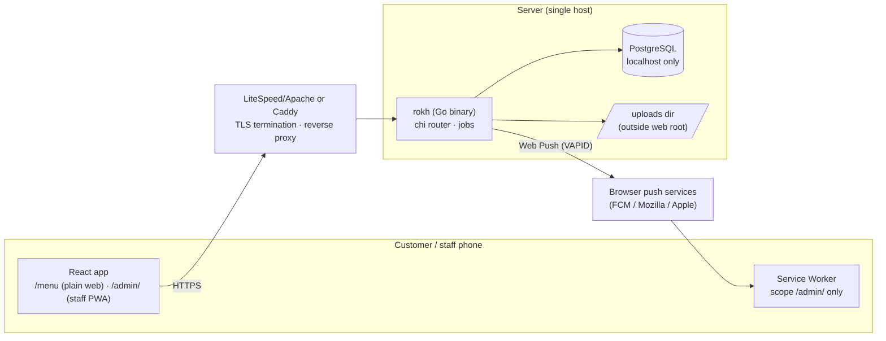

# Architecture — Rokh Tia Café

## 1. Shape

One **modular monolith**: a single Go binary that serves the REST API, the built React
app (two entry points, embedded with `go:embed`), uploaded images, and runs background jobs.
One PostgreSQL (>= 16) database on the same host, reachable only via localhost/unix socket.



Why: one deployable artifact, no broker, no cache server, trivial rollback (swap
binary). Volume is tiny; PostgreSQL row locks and `SKIP LOCKED` cover all concurrency.

## 2. Backend

### 2.1 Stack
Go **1.27.x**, chi v5, pgx v5 (pool), sqlc (pgx/v5 driver), goose v3 (migrations
embedded in the binary). Additional minimal deps:

| Dependency | Purpose |
|------------|---------|
| `golang.org/x/crypto/argon2` | password hashing |
| `golang.org/x/time/rate` | in-memory rate limiting |
| `golang.org/x/image/draw` | image resize |
| `github.com/SherClockHolmes/webpush-go` | VAPID Web Push encryption/sending |
| `log/slog` (stdlib) | structured logging |

No ORM, no DI framework, no validation library (explicit validation functions).

### 2.2 Layout

```
backend/
  cmd/rokh/main.go          # subcommands: serve | migrate up|status | user create | vapid gen | secret gen | check
  db/
    migrations/             # goose SQL files (embedded)
    queries/                # sqlc query files, one per module
  sqlc.yaml
  internal/
    config/                 # env parsing + validation, fail fast
    store/                  # sqlc-generated code (do not edit) + Tx helper
    httpx/                  # router, middleware, JSON + error helpers
    auth/                   # password hashing, sessions, CSRF, policy (Can(role, action))
    catalog/                # categories, products, images, public menu
    inventory/              # balances, movements, purchases, adjustments, WAC
    orders/                 # public ordering, tracking, state machine, expiry
    payments/               # payments, refunds, voids, payment_status
    expenses/
    reports/
    push/                   # subscriptions, outbox worker
    audit/                  # audit.Record(ctx, tx, ...)
    jobs/                   # ticker loop running module jobs
  web/                      # embed.go → frontend/dist copied at build time
```

### 2.3 Module rules
- Each module exposes `Service` (business logic) and `Handler` (HTTP). Handlers do
  parsing, authz check, call service, map errors. Services own transactions.
- Cross-module writes happen **inside one transaction**: services accept a
  `store.Querier` bound to a `pgx.Tx`. Example: `orders.Complete` calls
  `inventory.ConsumeReservation(ctx, q, ...)` and `audit.Record(ctx, q, ...)` in the same tx.
- No generic repository layer: sqlc queries are the data layer.
- Domain errors are typed (`ErrInsufficientStock`, `ErrIllegalTransition`, …) and mapped
  to the error codes in [API-CONTRACT.md §2](API-CONTRACT.md#2-conventions).

### 2.4 Transactions & concurrency
- Default isolation READ COMMITTED with `lock_timeout = 3s`, `statement_timeout = 10s`.
- **Every order mutation locks the order row first** (`SELECT … FOR UPDATE`) and runs its checks
  on the locked row; conditional UPDATEs and DB constraints remain as defence in depth.
- **Order creation is serialized** by one global advisory lock (`LOCK_ORDER_CREATE`), which makes
  idempotent replay, caps, and daily numbering race-free at café volume.
- Global lock order (advisory → order → products → balances ascending → payments) prevents
  deadlocks; see [DATABASE.md §3.1](DATABASE.md#31-lock-order).
- Jobs claim work with `FOR UPDATE SKIP LOCKED` (expiry: one order per tx) or short leases
  (push outbox), so a crash or a second instance cannot double-process.
- Full per-operation contracts: [WORKFLOWS.md §0](WORKFLOWS.md#0-transaction-contracts-summary).

### 2.5 Background jobs (in-process, `jobs` ticker)
| Job | Interval | Work |
|-----|----------|------|
| Expire pending orders | 30 s | One order per tx: lock with SKIP LOCKED, cancel EXPIRED, release reservations (≤ 100/tick) |
| Push outbox | 10 s | Claim ≤ 10 events with a 60 s lease (short tx), send outside tx (≤ 4 concurrent, 10 s timeout), finalize by claim token; expired leases are reclaimed |
| Session cleanup | 1 h | Delete expired sessions |
| Notification cleanup | 24 h | Delete SENT/FAILED/GONE events older than 30 days |

### 2.6 Time
All timestamps `timestamptz`. Business timezone `Asia/Tehran` (binary imports
`time/tzdata` so it works on Windows and minimal servers). "Business date" = local
date in Asia/Tehran. Jalali calendar handled only in the frontend via
`Intl.DateTimeFormat('fa-IR-u-ca-persian')`; the API speaks ISO dates.

## 3. Frontend

### 3.1 Stack
React + TypeScript + Vite, Tailwind CSS v4, shadcn/ui (Radix), TanStack Query,
React Hook Form + Zod, vite-plugin-pwa, React Router (only extra routing dep),
`@fontsource-variable/vazirmatn` (self-hosted font). No global state library: cart
uses a React context persisted to localStorage (prices in the cart are refreshed from the menu
API on load and confirmed at checkout — `409 PRICE_CHANGED` shows a confirmation sheet).

### 3.2 Layout
```
frontend/src/
  app/            # router, QueryClient, error boundary
  components/ui/  # shadcn components (generated, lightly themed)
  components/     # shared: Money, StatusBadge, EmptyState, PageHeader, ...
  features/
    menu/ cart/ order-tracking/                  # public bundle
    admin/{auth,dashboard,orders,catalog,inventory,purchases,expenses,reports,users,push}
  lib/            # api.ts (fetch + CSRF + error mapping), money.ts, date.ts, errors-fa.ts
  styles/tokens.css
```
Two Vite entry points (multi-page build): `index.html` → customer app (`/menu…`) and
`admin/index.html` → staff app (`/admin/…`). They share `components/` and `lib/` but are built
as separate bundles; the customer bundle never loads admin code.

### 3.3 Staff PWA
- Manifest is linked **only** from `admin/index.html`: name «رخ تیا — پنل کارکنان», `start_url: /admin/`,
  `scope: /admin/`, `display: standalone`, `dir: rtl`, `lang: fa`.
- Service worker served at `/admin/sw.js` with scope `/admin/`; precaches the staff app shell only;
  API calls are network-only (no stale prices or order states). Handles `push` and
  `notificationclick` (opens `/admin/inventory?filter=low`).
- Customer pages (`/menu`) have no manifest and no service worker: normal QR ordering in the
  browser, no install prompt, ordinary HTTP caching for hashed assets (review F12).

### 3.4 Design tokens (`styles/tokens.css`)
| Token | Light | Use |
|-------|-------|-----|
| `--background` | `#FBF7F2` cream | page |
| `--surface` | `#FFFFFF` | cards |
| `--foreground` | `#2B1E16` espresso | text (contrast 15:1 on cream) |
| `--muted` / `--muted-foreground` | `#F1E8DD` / `#6E5B4D` | secondary surfaces / text (≥ 4.5:1) |
| `--primary` / `--primary-foreground` | `#6B4226` coffee / `#FFF8F0` | main actions |
| `--accent` | `#B5835A` caramel | highlights (not for text) |
| `--border` | `#E4D6C5` | dividers |
| `--success` `--warning` `--danger` | `#2F6B4F` `#9A6212` `#B3261E` | states (all ≥ 4.5:1 on white) |
| `--radius` | `12px` | cards, buttons |
| spacing | 4 px scale (`1`=4px) | Tailwind default |
| type | Vazirmatn; 14/16/18/22/28 px | body 16 px minimum on mobile |

Order status colors: PENDING=warning, PREPARING=primary, READY=success, COMPLETED=muted, CANCELLED=danger — always paired with a text label, never color alone.
RTL: use logical utilities only (`ms-/me-/ps-/pe-/start-/end-`); numbers rendered with `fa-IR` digits.

## 4. Deployment architecture (pending server inspection)

Target is the existing cPanel/CloudLinux host. The app needs: a persistent process,
a reverse proxy from `rokh.tiacafe.ir` to `127.0.0.1:<port>`, PostgreSQL >= 16 with two roles,
and outbound HTTPS to push services. These are **not guaranteed** on shared hosting, so the
read-only feasibility assessment (T0) runs **before** implementation (review F14); see
[IMPLEMENTATION-PLAN.md §3](IMPLEMENTATION-PLAN.md#3-hosting-feasibility-assessment-t0).

Build artifact: `rokh` Linux amd64 static binary with embedded SPA + migrations.
Runtime layout (proposal):
```
~/rokh/
  bin/rokh, bin/rokh.prev        # rollback = swap and restart
  .env                           # 0600, not in git (runtime: DATABASE_URL as rokh_app)
  .env.migrate                   # 0600, MIGRATION_DATABASE_URL as rokh_owner; only for `rokh migrate`
  uploads/                       # product images (outside public_html)
  backups/                       # pg_dump + uploads tarballs, 14-day retention, copied off-server
```
Deploy procedure (manual, owner-approved): backup → upload binary → `rokh migrate up`
(as `rokh_owner`) → restart (as `rokh_app`) → health check → `rokh check` → keep previous binary. Migrations are forward-only and
must be backward-compatible with the previous binary for one release.

## 5. Observability
- `slog` JSON logs to stdout/file with request id, route, status, latency; never log
  passwords, tokens, cookies, or full push endpoints.
- `GET /healthz` (process up) and `GET /readyz` (DB reachable).

## 6. Explicitly rejected
Microservices, Kubernetes, Redis, message brokers, GraphQL, ORMs, WebSockets/SSE,
multi-tenancy, event sourcing, generic CRUD frameworks.
