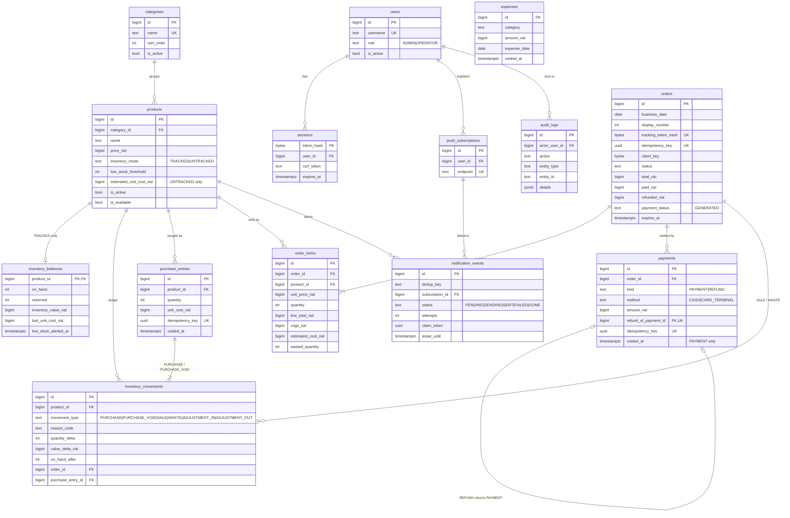

# ERD — Rokh Tia Café

Column details and constraints: [DATABASE.md](DATABASE.md). Audit FKs to `users`
(`created_by`, `voided_by`, `accepted_by`, …) are omitted from the diagram for readability.

## Migration order
1. `users`, `sessions`
2. `categories`, `products`, `inventory_balances`
3. `purchase_entries`, `orders`, `order_items`, `inventory_movements`
4. `payments`, `expenses`
5. `push_subscriptions`, `notification_events`, `audit_logs`
6. Triggers (`forbid_delete`, `forbid_update`, `order_items_guard`, `orders_guard`, `void_only_update`, `set_updated_at`)
7. Grants: `rokh_owner` owns everything; `rokh_app` gets runtime grants ([DATABASE.md §6.1](DATABASE.md#61-roles)). The two roles themselves are created once by the setup script (local: docker-compose init; server: host tooling), not by migrations.
