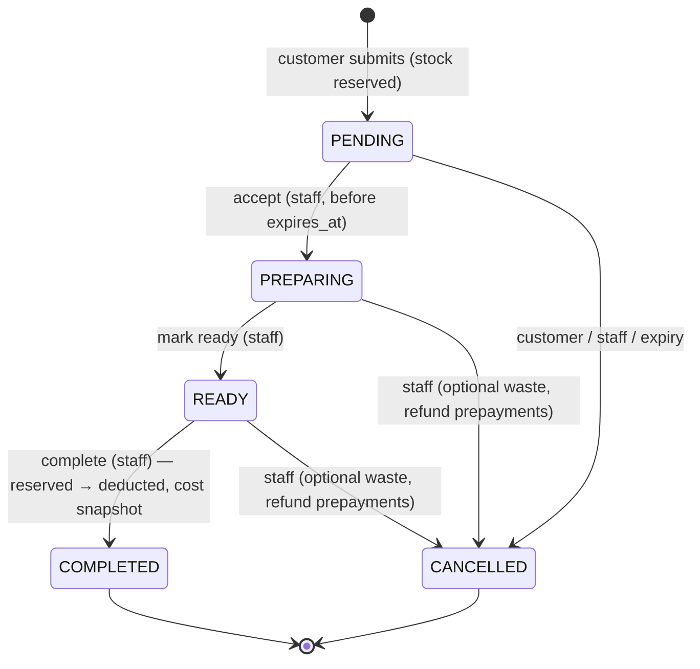

# Workflows — Rokh Tia Café

Every workflow below runs in **one database transaction** unless stated otherwise, writes an
`audit_logs` row in that transaction, and acquires locks in the global order defined in
[DATABASE.md §3.1](DATABASE.md#31-lock-order). Review-driven changes are tagged *(Fn)*.

## 0. Transaction contracts (summary)

| Operation | Lock(s) taken, in order | Checks after locking | Writes |
|-----------|------------------------|----------------------|--------|
| Create order (§1.2) | `LOCK_ORDER_CREATE` → products FOR SHARE → balances | idempotency replay → hours/kill-switch → caps → prices → availability → stock | order, items, balances.reserved, audit |
| Accept | order | status PENDING; `now() < expires_at` (else expire, §1.4) | order |
| Ready | order | status PREPARING | order |
| Complete (§1.3) | order → balances | status READY | order, items.cogs/estimated, balances, SALE movements, low-stock events |
| Cancel (§1.5) | order → balances → payments | status open; waste only if PREPARING/READY | order, items.wasted, balances, WASTE movements, REFUND rows, `refunded_rial` |
| Expire (§1.4) | order (SKIP LOCKED) | status PENDING, `expires_at ≤ now()` | order, balances |
| Record payment (§3) | order | status PREPARING/READY/COMPLETED; `refunded_rial = 0`; amount ≤ total − paid | PAYMENT, `paid_rial` |
| Refund completed (§3) | order → payments | COMPLETED; `payment_status = PAID` | REFUND rows, `refunded_rial` |
| Void payment (§3) | order → payment | PAYMENT not void; `refunded_rial = 0`; order not CANCELLED | void cols, `paid_rial` |
| Purchase / adjustment / purchase void (§2) | balance | §2 rules | balance, movement, (purchase) |
| Role/active change | `LOCK_ADMIN_MEMBERSHIP` → user | INV-16 | user, sessions |

All order-mutating operations — transitions, expiry, payments, refunds, voids, cancellation —
**start with `SELECT … FROM orders WHERE id = $1 FOR UPDATE`** *(F1)*. Business checks run
on the locked row, so two of them can never interleave on the same order. The UPDATE
statements keep their `WHERE status = $expected` guards as defence in depth.

Transactions use READ COMMITTED with `lock_timeout = 3s` and `statement_timeout = 10s`;
a lock timeout returns `503 BUSY_RETRY` (safe to retry with the same idempotency key).

## 1. Order lifecycle



| From | To | Actor | Precondition | Side effects |
|------|----|-------|--------------|--------------|
| – | PENDING | Customer | §1.2 | Reserve tracked stock, assign number, `expires_at = now + ORDER_PENDING_TTL` |
| PENDING | PREPARING | OPERATOR/ADMIN | `now() < expires_at` *(F2)* | `accepted_at/by` |
| PREPARING | READY | OPERATOR/ADMIN | – | `ready_at` |
| READY | COMPLETED | OPERATOR/ADMIN | – | §1.3 |
| PENDING | CANCELLED | Customer (token) | – | Release reservations; `CUSTOMER` |
| PENDING | CANCELLED | System / any accept attempt after deadline | `expires_at ≤ now()` | Release reservations; `EXPIRED` |
| PENDING/PREPARING/READY | CANCELLED | OPERATOR/ADMIN | – | §1.5 |

COMPLETED and CANCELLED are terminal. There is no "un-complete" — see §6 for supported corrections.

### 1.1 Transition mechanics
```sql
SELECT * FROM orders WHERE id = $id FOR UPDATE;      -- serialization point
-- Go: if status == target → return 200 (no side effects, idempotent double-tap)
--     if status != expected_from → 409 ILLEGAL_TRANSITION
UPDATE orders SET status = $to, <timestamps>, updated_at = now()
WHERE id = $id AND status = $expected_from;           -- defence in depth; must affect 1 row
```

### 1.2 Create order (public)
Before the transaction: validate shape (1–15 items, qty 1–20, unique product ids, text limits),
compute `request_hash` = SHA-256 of canonical JSON (items sorted by product_id, including the
expected prices), compute `client_key = HMAC(APP_SECRET_KEY, "ip:" || client_ip)`.
Per-IP and per-client-id rate limits are checked in memory (SECURITY §5) — **but a request
whose idempotency key already exists bypasses them** (replay is checked first, below).

1. `BEGIN`
2. `SELECT pg_advisory_xact_lock(LOCK_ORDER_CREATE)` — **one global lock serializes all order
   creation**. At café volume (≤ a few orders/minute; each tx ≈ 5–20 ms) this is not a bottleneck
   and it makes steps 3–9 race-free.
3. **Idempotency first:** `SELECT … FROM orders WHERE idempotency_key = $k`.
   Found & same `request_hash` → `COMMIT`, return `200` with the order's *current* state and
   the re-derived tracking token. Found & different hash → `409 IDEMPOTENCY_KEY_REUSED`.
   Because the replay is checked before steps 4–8, a retry of an order that already succeeded
   is never rejected by closing time, caps, price changes, or stock that the original order
   itself consumed.
4. Ordering open? (`ORDERING_HOURS` evaluated at tx `now()` in Asia/Tehran, plus the in-memory
   kill switch) → else `503 ORDERING_CLOSED`.
5. Caps (serialized by step 2): open PENDING orders ≥ `ORDER_MAX_PENDING` → `503 ORDERING_BUSY`;
   open PENDING orders with this `client_key` ≥ `ORDER_MAX_PENDING_PER_CLIENT` → `429 TOO_MANY_OPEN_ORDERS`.
6. `SELECT … FROM products WHERE id = ANY($ids) ORDER BY id FOR SHARE` (price edits wait for us).
   Any line whose `expected_unit_price_rial ≠ price_rial` → `409 PRICE_CHANGED` with current prices.
7. All products `is_active AND is_available` and category active → else `422 PRODUCT_UNAVAILABLE`.
8. For each TRACKED line in ascending product_id:
   `UPDATE inventory_balances SET reserved = reserved + $q WHERE product_id = $p AND on_hand - reserved >= $q`.
   0 rows → `ROLLBACK`, `409 INSUFFICIENT_STOCK` (failing ids collected by a read-only check before rollback).
9. `display_number = coalesce(max(display_number), 0) + 1` for today's business date.
10. Tracking token = base64url(HMAC-SHA256(`APP_SECRET_KEY`, `"trk:" || idempotency_key`)) (43 chars);
    store only `SHA-256(token)`.
11. Insert order (`expires_at = now() + ORDER_PENDING_TTL`) and items with snapshots.
12. Low-stock evaluation for each reserved product (§4). Audit `order.create` (actor CUSTOMER).
13. `COMMIT` → `201`.

### 1.3 Complete
After locking the order (status READY → COMPLETED), for each TRACKED line in ascending product_id:
```sql
SELECT on_hand, reserved, inventory_value_rial FROM inventory_balances WHERE product_id = $p FOR UPDATE;
-- cost = round_half_up(value × q / on_hand)
UPDATE inventory_balances
SET on_hand = on_hand - $q, reserved = reserved - $q, inventory_value_rial = inventory_value_rial - $cost
WHERE product_id = $p AND reserved >= $q;
```
Insert `SALE` movement; set `order_items.cogs_rial = $cost`. UNTRACKED lines: `cogs_rial = 0`,
`estimated_cost_rial = q × estimated_unit_cost_rial` (NULL if no estimate). A failed balance
update means INV-3 is broken → abort with `500`, log loudly. Payment state is not checked:
unpaid completed orders become receivables (§3.1).

### 1.4 Expiry and the acceptance deadline
- `ORDER_PENDING_TTL` default **20 minutes**; `expires_at` is the **acceptance deadline**.
- **Accept** checks `now() < expires_at` on the locked row. If the deadline has passed, the same
  transaction expires the order (CANCELLED/EXPIRED, reservations released), commits, and returns
  `409 ORDER_EXPIRED`. A DB CHECK also requires `accepted_at < expires_at`.
- **Expiry job** (every 30 s) processes orders **one per transaction**:
  ```sql
  BEGIN;
  SELECT * FROM orders WHERE status = 'PENDING' AND expires_at <= now()
  ORDER BY expires_at LIMIT 1 FOR UPDATE SKIP LOCKED;
  -- cancel with EXPIRED, release reservations (same tx, same lock)
  COMMIT;
  ```
  repeated up to 100 times per tick. The row lock that selected the order is the one held while
  it is cancelled — there is no gap between selection and update.
- Customer cancel and staff cancel on an order already expired return `200` (target state reached)
  for customer, `409 ILLEGAL_TRANSITION` with `current_status=CANCELLED` for staff.
- PENDING orders never hold money (DB CHECK), so expiry never needs a refund.
- Public tracking shows `expires_at`; once past, the UI shows «منقضی شد» even if the job has not run yet.

### 1.5 Cancel
Body: `{ note, waste?: [{product_id, quantity}] }`. Steps on the locked order:
1. Status must be PENDING/PREPARING/READY. `waste` allowed only for PREPARING/READY, each
   `quantity ≤` line quantity.
2. For each TRACKED line (ascending product_id): release `reserved -= q`. For wasted quantity `w`:
   additionally `on_hand -= w`, `value -= round_half_up(value × w / on_hand)` and a `WASTE`
   movement linked to the order. Wasted goods were physically consumed, so they leave stock at
   average cost and appear as **inventory losses**. Non-wasted quantity returns to availability.
3. UNTRACKED wasted quantity: set `wasted_quantity` and `estimated_cost_rial` (informational "estimated waste").
4. **Prepayments:** if `paid_rial > 0`, create one REFUND per non-void PAYMENT (same method and
   amount), set `refunded_rial = paid_rial`. Allowed for OPERATOR because it only returns money
   taken for this not-yet-completed order. The response lists the amounts per method to hand back.
5. Set CANCELLED/STAFF. DB CHECK guarantees `paid_rial = refunded_rial` on cancelled orders.

## 2. Inventory

| Operation | Who | Effect on balance | Movement |
|-----------|-----|-------------------|----------|
| Purchase | ADMIN | `on_hand += q`, `value += q·c` | PURCHASE |
| Purchase void *(F4)* | ADMIN | only if no outflow since the purchase and `available ≥ q`; `on_hand -= q`, `value -= q·c` exactly | PURCHASE_VOID |
| Adjustment in | ADMIN | `on_hand += q`, `value += q·unit_cost`; reason `OPENING_BALANCE` / `COUNT_CORRECTION` / `RETURN_TO_STOCK` + note | ADJUSTMENT_IN |
| Adjustment out | ADMIN | requires `available ≥ q`; `on_hand -= q`, `value -= avg cost`; reason `COUNT_CORRECTION` / `DAMAGED` / `EXPIRED` + note | ADJUSTMENT_OUT |
| Reserve | Customer order | `reserved += q` | none |
| Release | Cancel/expire | `reserved -= q` | none |
| Sale | Complete | `on_hand -= q`, `reserved -= q`, `value -= avg cost` | SALE |
| Waste *(F7)* | Cancel after preparation | `reserved -= q`, `on_hand -= w`, `value -= avg cost(w)` | WASTE |

Adjustments and voids cannot eat into reserved stock — otherwise a pending order could become
unfulfillable. Purchase void details: [DATABASE.md §5.1](DATABASE.md#51-tracked-products--moving-weighted-average-value-based).

## 3. Payments

`paid_rial` = Σ non-void PAYMENT; `refunded_rial` = Σ REFUND (refunds cannot be voided).
`payment_status` (generated): `REFUNDED` if `refunded_rial > 0`; `PAID` if `paid_rial = total_rial`;
else `UNPAID` (includes partially paid; UI shows "remaining X").

| Action | Who | Preconditions (on the locked order) | Result |
|--------|-----|-------------------------------------|--------|
| Record payment | OPERATOR/ADMIN | status PREPARING/READY/COMPLETED; `refunded_rial = 0`; `amount ≤ total − paid_rial` | PAYMENT row; `paid_rial += amount` |
| Refund completed order | ADMIN | COMPLETED and `payment_status = PAID` | one REFUND per non-void PAYMENT (same method/amount); `refunded_rial = paid_rial` |
| Refund prepayment | OPERATOR/ADMIN | only as part of Cancel (§1.5) | same as above, then CANCELLED |
| Void payment | ADMIN | PAYMENT not void; `refunded_rial = 0`; order not CANCELLED | void columns set; `paid_rial -= amount` |

- No payments on PENDING orders: staff accept first (one tap). This keeps expiry and customer
  cancellation money-free.
- Partial payment (split tender) is allowed; partial **refunds** are not (MVP).
- Refund of a completed order requires it to be fully paid. A partially paid completed order is
  first settled (collect the rest) or corrected (void), then refunded.
- Idempotency: payment POST requires `Idempotency-Key` (unique on `payments`). Refund, void and
  cancel are **state-idempotent**: repeating them after success finds the target state already
  reached under the order lock and returns `200` without new rows.
- Change-giving is outside the system: staff record the exact amount applied to the order.

### 3.1 Revenue, receivables and cash policy
| Event | Revenue | COGS | Cash collected | Receivable |
|-------|---------|------|----------------|------------|
| Payment on open order | – | – | +amount (by method, payment date) | – |
| Completion | +total (completion date) | +cogs | – | +(total − paid) |
| Payment after completion | – | – | +amount | −amount |
| Refund of completed (fully paid) order | −total (refund date) | unchanged | −amount | 0 (stays 0) |
| Cancel with prepayment refund | – (never recognised) | – | −amount (prepayment refund) | – |
| Void payment (data-entry error) | – | – | voided row excluded from all cash figures (as if never recorded) | +amount if completed |

Identity checked by an acceptance test: for completed orders, **net revenue = net cash collected + receivables**.
Unpaid completed orders stay receivables until paid; write-off is not in MVP (owner decision O3).

## 4. Low stock & Web Push

### 4.1 Detection (inside the tx that changed the balance)
For TRACKED products with `low_stock_threshold IS NOT NULL`:
- If `available ≤ threshold` and `low_stock_alerted_at IS NULL` → set `low_stock_alerted_at = now()`
  and insert one `notification_events` row per ADMIN push subscription with
  `dedup_key = 'LOW_STOCK:' || product_id || ':' || epoch(low_stock_alerted_at)`.
- Re-arm: on PURCHASE or ADJUSTMENT_IN, if `available > threshold` → `low_stock_alerted_at = NULL`.
  (Not re-armed by reservation release, to avoid alert flapping from expiring orders.)
- Dashboard low-stock list is computed live from balances, so it works with zero subscriptions (fallback).

### 4.2 Delivery — leased outbox
The worker never holds a transaction during network I/O.

1. **Claim** (short tx, every 10 s):
   ```sql
   UPDATE notification_events SET status = 'SENDING', claim_token = $uuid,
          lease_until = now() + interval '60 seconds', attempts = attempts + 1
   WHERE id IN (
     SELECT id FROM notification_events
     WHERE (status = 'PENDING' AND next_attempt_at <= now())
        OR (status = 'SENDING' AND lease_until < now())          -- crashed worker's claims
     ORDER BY id LIMIT 10 FOR UPDATE SKIP LOCKED)
   RETURNING *;
   ```
2. **Send** outside any tx: at most 4 concurrent, HTTP timeout 10 s (< lease), no redirects,
   SSRF-safe dialer (SECURITY §12). Headers: `TTL: 21600`, `Urgency: high`,
   `Topic: low-stock-<product_id>` (push services replace an undelivered message with the same
   topic, so a duplicate after a crash collapses). Payload ≤ 2 KB.
3. **Finalize** (short tx) `WHERE id = $id AND status = 'SENDING' AND claim_token = $uuid`
   (a stale worker whose lease was taken over updates 0 rows and does nothing):
   - 2xx → `SENT`, `sent_at`; subscription `last_success_at`, `failure_count = 0`.
   - 404/410 → `GONE`; delete the subscription.
   - 429/5xx/timeout → `PENDING`, `next_attempt_at = now + [1m, 5m, 15m, 60m][attempts-1]`
     (honour `Retry-After` if larger).
   - Other 4xx, or `attempts = 5`, or event older than 24 h → `FAILED`; `failure_count++`;
     subscriptions with `failure_count ≥ 10` are deleted.
4. Delivery is **at-least-once and best-effort**; the UI never claims guaranteed delivery.
5. Cleanup job: delete SENT/FAILED/GONE rows older than 30 days.

### 4.3 Subscribing (client)
1. ADMIN taps «فعال‌سازی اعلان‌ها» in the installed staff app (permission only requested on this tap).
2. iOS: only when running as an installed home-screen PWA (iOS/iPadOS 16.4+); otherwise the button explains how to install.
3. `pushManager.subscribe({ userVisibleOnly: true, applicationServerKey })` → `POST /admin/push/subscriptions`
   (server rejects endpoints outside the push-service allowlist).
4. «ارسال اعلان آزمایشی» button verifies the device.

## 5. Authentication

- Login → verify argon2id (dummy verify for unknown users) → create session (32 random bytes,
  cookie holds token, DB holds SHA-256) → return CSRF token.
- Each request: look up session by hash joined with user; reject if expired or user inactive; slide
  `last_seen_at` (write at most once per 5 min); idle timeout 12 h, absolute lifetime 7 days.
- Unsafe methods: require `X-CSRF-Token` = session's token **and** `Origin` equal to `APP_BASE_URL`.
- Password change/reset, deactivation, and role change revoke the user's sessions in the same tx.
- Role/active changes take `LOCK_ADMIN_MEMBERSHIP` before counting active admins *(F11)*.
- First admin is created on the server with `rokh user create --role ADMIN` (password read from stdin, never from args/env).

## 6. Supported corrections

Only these corrections exist. There is no generic "reverse" operation. Each is audited with
actor, reason, and before/after values.

| Mistake | Correction | Who | Financial effect |
|---------|-----------|-----|------------------|
| Wrong payment amount/method | Void the PAYMENT (reason required), record the correct one | ADMIN | Cash report changes; revenue unchanged |
| Customer paid, then order cancelled before completion | Cancel (auto-refunds prepayments) | OPERATOR/ADMIN | Cash −; never revenue |
| Completed order returned / complaint | Refund (full, mirrors payments) | ADMIN | Revenue − on refund date; COGS unchanged |
| Packaged item returned unopened after completion | Refund + `ADJUSTMENT_IN` `RETURN_TO_STOCK` at current average (or last) cost | ADMIN | Revenue −; inventory gain offsets COGS |
| Order completed by mistake (not handed over) | Same as the previous two rows; there is no un-complete | ADMIN | as above |
| Purchase entered wrong, nothing consumed since | Purchase void (exact) + re-enter | ADMIN | Exact restoration |
| Purchase entered wrong, stock already consumed | `COUNT_CORRECTION` adjustments with note referencing the purchase; re-enter if needed | ADMIN | Shown as inventory gain/loss; historical COGS unchanged |
| Physical count differs | `ADJUSTMENT_IN/OUT` `COUNT_CORRECTION` | ADMIN | Inventory gain/loss |
| Expense entered wrong | Void + re-enter | ADMIN | Expenses corrected |
| Refund recorded by mistake | **Not supported in MVP** (refunds are final); record explanation in audit note | — | Owner decision O7 |
| Unpaid completed order never paid | **Not supported in MVP** (stays a receivable) | — | Owner decision O3 |
