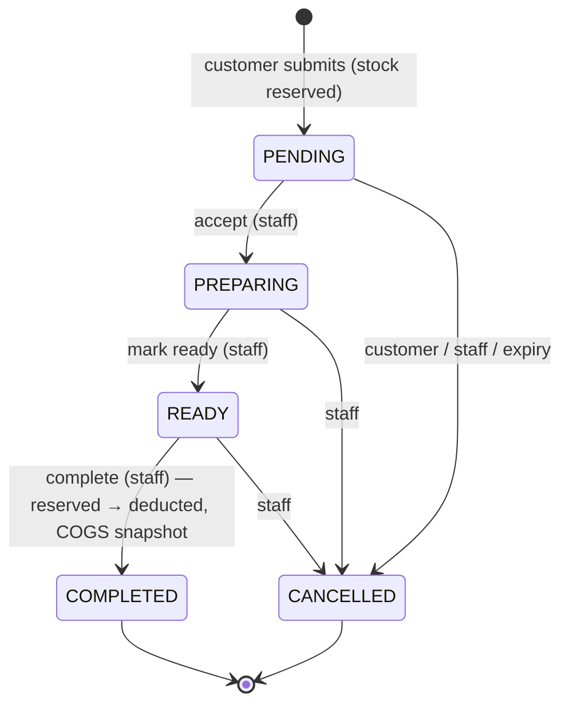

# Workflows — Rokh Tia Café

Every workflow below runs in **one database transaction** unless stated otherwise, and
writes an `audit_logs` row in that transaction.

## 1. Order lifecycle



| From | To | Actor | Precondition | Side effects |
|------|----|-------|--------------|--------------|
| – | PENDING | Customer | Ordering open, under global cap, rate limit OK | Reserve tracked stock, assign number, set `expires_at = now + ORDER_PENDING_TTL` |
| PENDING | PREPARING | OPERATOR/ADMIN | – | `accepted_at/by`; expiry no longer applies |
| PREPARING | READY | OPERATOR/ADMIN | – | `ready_at` |
| READY | COMPLETED | OPERATOR/ADMIN | – | Deduct stock, write SALE movements, set `cogs_rial`, low-stock check |
| PENDING | CANCELLED | Customer (token) | – | Release reservations; `cancel_reason=CUSTOMER` |
| PENDING | CANCELLED | System job | `expires_at < now()` | Release reservations; `cancel_reason=EXPIRED` |
| PENDING/PREPARING/READY | CANCELLED | OPERATOR/ADMIN | net paid = 0 | Release reservations; `cancel_reason=STAFF` |

COMPLETED and CANCELLED are terminal. There is no "un-complete"; a mistaken completion is
handled by refund (money) and `ADJUSTMENT_IN` (stock, if goods were not actually consumed).

### 1.1 Transition mechanics
```sql
UPDATE orders SET status = $to, <timestamps>, updated_at = now()
WHERE id = $id AND status = $expected_from
RETURNING *;
```
- 1 row → apply side effects in the same tx.
- 0 rows → read current status: if it already equals `$to` → return `200` (no side effects);
  else → `409 ILLEGAL_TRANSITION`.
This makes double-taps and concurrent staff actions safe; side effects run only for the
request that actually moved the row.

### 1.2 Create order (public)
1. Validate body; reject unknown fields (prices included).
2. Check ordering hours (`ORDERING_HOURS`, Asia/Tehran) → `503 ORDERING_CLOSED`.
3. Compute `request_hash` = SHA-256 of canonical JSON (items sorted by product_id).
4. `BEGIN`
5. `SELECT … FROM orders WHERE idempotency_key = $k` → if exists: same hash → replay response; different → `409`.
6. Global cap: `SELECT count(*) FROM orders WHERE status='PENDING'` ≥ `ORDER_MAX_PENDING` → `503 ORDERING_BUSY`.
7. Load products `WHERE id = ANY($ids)`; all must be `is_active AND is_available` and category active → else `422 PRODUCT_UNAVAILABLE`.
8. For each TRACKED item, **in ascending product_id**:
   ```sql
   UPDATE inventory_balances SET reserved = reserved + $q, updated_at = now()
   WHERE product_id = $p AND on_hand - reserved >= $q
   RETURNING on_hand, reserved;
   ```
   0 rows → `ROLLBACK`, `409 INSUFFICIENT_STOCK` (collect all failing ids by checking remaining items read-only before rollback).
9. `pg_advisory_xact_lock(hashtext('order_no:' || business_date))`; `display_number = coalesce(max,0)+1` for that date.
10. Insert `orders` (server-computed total from DB prices, random 128-bit `tracking_token`, `ON CONFLICT (idempotency_key) DO NOTHING` — if conflict, rollback and go to step 5 behaviour).
11. Insert `order_items` with snapshots.
12. Low-stock evaluation for each reserved product (§4).
13. Audit `order.create` (actor_kind CUSTOMER).
14. `COMMIT` → `201`.

### 1.3 Complete
After the conditional UPDATE succeeds, for each TRACKED line (ascending product_id):
```sql
UPDATE inventory_balances
SET on_hand = on_hand - $q,
    reserved = reserved - $q,
    inventory_value_rial = inventory_value_rial - $cost
WHERE product_id = $p AND reserved >= $q
RETURNING on_hand, inventory_value_rial;
```
where `$cost = round_half_up(value × q / on_hand)` computed from the row locked with
`SELECT … FOR UPDATE` just before. Insert `SALE` movement (unique index guarantees once),
set `order_items.cogs_rial = $cost` (UNTRACKED lines: `0`). 0 rows here means INV-3 is
broken → abort with `500` and log loudly (should be impossible).

### 1.4 Cancel / expire
Conditional UPDATE to CANCELLED, then for each TRACKED line:
`UPDATE inventory_balances SET reserved = reserved - $q WHERE product_id=$p AND reserved >= $q`.
Expiry job: `SELECT id FROM orders WHERE status='PENDING' AND expires_at < now() ORDER BY id LIMIT 50 FOR UPDATE SKIP LOCKED`, then cancel each in its own tx with `cancel_reason=EXPIRED`.

### 1.5 Pending-order expiration policy
- `ORDER_PENDING_TTL` default **20 minutes**, configurable.
- Applies only to PENDING. Once accepted, an order never expires.
- Customer tracking page shows a countdown-free message: «اگر سفارش تا ۲۰ دقیقه تأیید نشود، خودکار لغو می‌شود».
- Staff UI highlights PENDING orders older than 5 minutes.

## 2. Inventory

| Operation | Who | Effect on balance | Movement |
|-----------|-----|-------------------|----------|
| Purchase | ADMIN | `on_hand += q`, `value += q·c` | PURCHASE |
| Purchase void | ADMIN | requires `on_hand − reserved ≥ q`; `on_hand -= q`, `value -= min(q·c, value)` (all value if `q = on_hand`) | PURCHASE_VOID |
| Adjustment in | ADMIN | `on_hand += q`, `value += q·unit_cost` | ADJUSTMENT_IN (reason required) |
| Adjustment out | ADMIN | requires `on_hand − reserved ≥ q`; `on_hand -= q`, `value -= avg cost` | ADJUSTMENT_OUT (reason required) |
| Reserve | Customer order | `reserved += q` | none |
| Release | Cancel/expire | `reserved -= q` | none |
| Sale | Complete | `on_hand -= q`, `reserved -= q`, `value -= avg cost` | SALE |

Adjustments and voids cannot eat into reserved stock — otherwise a pending order could
become unfulfillable. Admin must cancel orders first.

## 3. Payments

Definitions per order (non-voided rows only):
`paid = Σ PAYMENT.amount`, `refunded = Σ REFUND.amount`, `net_paid = paid − refunded`.

`payment_status` projection:
- `REFUNDED` if `refunded > 0` and `net_paid = 0`
- `PAID` if `net_paid = total_rial`
- `UNPAID` otherwise (includes partial split-tender; UI shows the remaining amount)

| Action | Who | Preconditions | Result |
|--------|-----|---------------|--------|
| Record payment | OPERATOR/ADMIN | order not CANCELLED; status not PAID/REFUNDED; `paid + amount ≤ total` | PAYMENT row; status → PAID when fully covered |
| Refund | ADMIN | `net_paid > 0` | REFUND row of `net_paid` amount; status → REFUNDED |
| Void payment/refund (data-entry correction) | ADMIN | row not already void; result must keep `0 ≤ net_paid ≤ total` | sets void columns; status recomputed |
| Cancel order | OPERATOR/ADMIN | `net_paid = 0` | – |

- Payment can be recorded at any status except CANCELLED (pay-first or pay-on-pickup both work).
- **Refund** = money actually returned to the customer. **Void** = the original entry was a mistake (wrong method/amount); nothing physically happened.
- Change-giving is outside the system: staff record the exact order amount.
- Every action is audited with actor, amount, method and reason. Nothing is deleted.

## 4. Low stock & Web Push

### 4.1 Detection (inside the tx that changed the balance)
For TRACKED products with `low_stock_threshold IS NOT NULL`:
- If `available ≤ threshold` and `low_stock_alerted_at IS NULL` → set `low_stock_alerted_at = now()`
  and insert one `notification_events` row per active ADMIN push subscription with
  `dedup_key = 'LOW_STOCK:' || product_id || ':' || epoch(low_stock_alerted_at)`.
- Re-arm: on PURCHASE or ADJUSTMENT_IN, if `available > threshold` → `low_stock_alerted_at = NULL`.
  (Not re-armed by reservation release, to avoid alert flapping from expiring orders.)
- Dashboard low-stock list is computed live from balances, so it works with zero subscriptions (fallback).

### 4.2 Delivery (push worker, every 10 s)
1. `SELECT … FROM notification_events WHERE status='PENDING' AND next_attempt_at ≤ now() ORDER BY id LIMIT 20 FOR UPDATE SKIP LOCKED`.
2. Send via VAPID (`TTL` 6 h, `Urgency: high`, payload ≤ 1 KB: `{type, title, body, url}` in Persian).
3. Outcome:
   - 2xx → `SENT`, subscription `last_success_at`, `failure_count = 0`.
   - 404/410 → `GONE`, delete the subscription.
   - 429/5xx/network → `attempts++`, `next_attempt_at = now + [1m, 5m, 15m, 60m][attempts-1]`; after 4 attempts or event older than 24 h → `FAILED`, subscription `failure_count++`; subscriptions with `failure_count ≥ 10` are deleted.
   - Other 4xx → `FAILED`.
4. Push is best-effort; the UI never claims delivery is guaranteed.

### 4.3 Subscribing (client)
1. ADMIN taps «فعال‌سازی اعلان‌ها» (permission only requested on this tap).
2. iOS: only when running as an installed home-screen PWA (iOS/iPadOS 16.4+); otherwise the button explains how to install.
3. `pushManager.subscribe({ userVisibleOnly: true, applicationServerKey })` → `POST /admin/push/subscriptions`.
4. «ارسال اعلان آزمایشی» button verifies the device.

## 5. Authentication

- Login → verify argon2id (dummy verify for unknown users) → create session (32 random bytes,
  cookie holds token, DB holds SHA-256) → return CSRF token.
- Each request: look up session by hash; reject if expired or user inactive; slide
  `last_seen_at` (write at most once per 5 min); idle timeout 12 h, absolute lifetime 7 days.
- Unsafe methods: require `X-CSRF-Token` = session's token **and** `Origin` equal to `APP_BASE_URL`.
- Password change/reset, deactivation, and role change revoke the user's sessions.
- First admin is created on the server with `rokh user create --role ADMIN` (password read from stdin, never from args/env).
